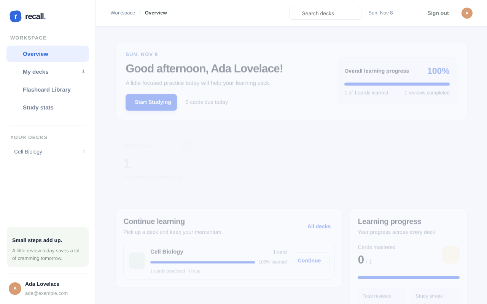

# Recall: make it stick

A calm, installable flashcard app with automatic spaced repetition. Sign in with Google, build decks, study; Recall schedules every card's next review and syncs your progress across devices.

| Layer | Tech | Hosted on |
|-------|------|-----------|
| Frontend | HTML · CSS · vanilla JS · PWA | **Vercel** |
| Auth | **Firebase Authentication** (Google) | Google |
| Backend | Node.js REST API, zero runtime dependencies | **Render** |
| Database | **Supabase** PostgreSQL | Supabase |



## Repository layout

```
frontend/   static app (deploy to Vercel, root directory = frontend)
backend/    REST API (deploy to Render, root directory = backend)
supabase/   schema.sql (run once in the Supabase SQL editor)
docs/       problem statement, architecture, API, security, testing, deployment, iteration log, presentation guide, ADRs
e2e/        browser end-to-end check (Playwright)
render.yaml Render blueprint
```

## Quick start

```bash
# 1. Database: run supabase/schema.sql in the Supabase SQL editor
# 2. API
cd backend && cp .env.example .env   # fill in Firebase project id + Supabase URL / service_role key
npm run dev                          # http://localhost:8080
# 3. Frontend: edit frontend/config.js (apiUrl + Firebase web config), then serve it
cd ../frontend && npx serve -l 5502
```

Run the tests: `cd backend && npm test` (Node 20+, nothing to install).

## Documentation

Start at **[docs/README.md](docs/README.md)**. The reading order is problem → solution → architecture → API → security → testing → deployment → iteration log → presentation guide.

To go live, follow **[docs/07-deployment-guide.md](docs/07-deployment-guide.md)**.

## Security note

Never commit a Supabase `service_role` key or a `.env` file. The key belongs only in Render's environment variables. Details: [docs/05-security-and-privacy.md](docs/05-security-and-privacy.md).
