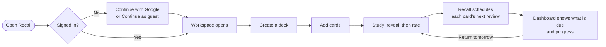
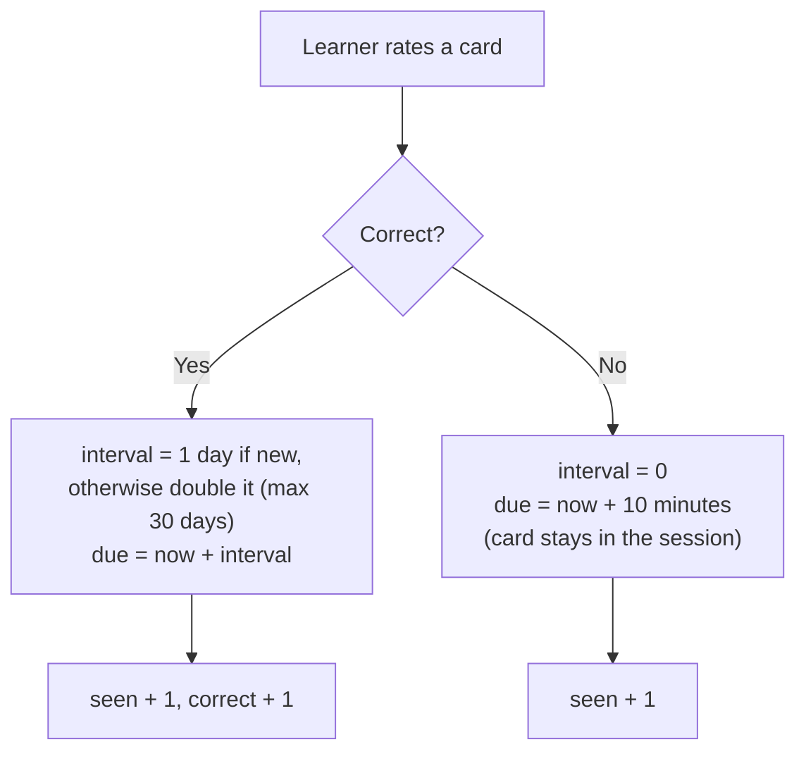

# 2. Solution overview

## 2.1 What Recall is

**Recall** is a calm, installable flashcard web app. A learner signs in with Google, builds decks of question-and-answer cards, and studies them. Recall decides when each card should come back, so the learner only has to show up.

> *Make what you learn stay with you.*

## 2.2 How the solution answers the problem

| Problem (from [§1](01-problem-statement.md)) | Recall's answer |
|----------------------------------------------|-----------------|
| Passive re-reading does not stick | Every card is a **recall test**: see the question, think, reveal, self-rate |
| Doing spaced review by hand is tedious | **Automatic scheduling**: correct → 1, 2, 4, 8… ≤ 30 days; missed → 10 minutes |
| Tools are heavy to start | **One-click Google sign-in**, or **guest mode** with no account; empty, uncluttered workspace |
| Progress trapped in one browser | **Cloud sync** through the Recall API to Supabase; the same decks on phone and laptop |
| Needs to be reachable anywhere | Hosted on Vercel over HTTPS; **installable PWA**; responsive layout |
| Learner data must be safe | Firebase-verified identity on every request; per-user data isolation; no secrets in the browser |

## 2.3 Key features

- **Dashboard**: cards due today, deck overview, accuracy, study streak
- **Decks and cards**: create, edit, delete; search and sort; subject and icon per deck
- **Study mode**: reveal answer → *Got it* / *Study again*; shuffle option; missed cards retry immediately
- **Spaced repetition**: server-side scheduling (see [§2.5](#25-the-scheduling-rule))
- **Statistics**: reviews, accuracy, streak, mastery per deck
- **Continue with Google**: Firebase Authentication; profile name and photo shown in the app
- **Guest mode**: try everything instantly; data stays on that device
- **PWA**: install to home screen, offline launch of the app shell

## 2.4 The learner journey

## 2.5 The scheduling rule

Deliberately simple, so it is explainable in one sentence and testable:

| Consecutive correct answers | 1st | 2nd | 3rd | 4th | 5th | 6th+ |
|-----------------------------|-----|-----|-----|-----|-----|------|
| Next review in | 1 d | 2 d | 4 d | 8 d | 16 d | 30 d |

The rule lives **on the server** (`backend/src/services/scheduler.js`) so every device agrees and the logic can be improved without redeploying the frontend. The browser applies it optimistically for instant feedback, then adopts the server's authoritative result.

## 2.6 Why this approach (and not another)

- **Why spaced repetition + retrieval practice?** They are the two highest-utility techniques identified in the research cited in §1.8.
- **Why a simple doubling rule rather than a full algorithm such as SM-2?** It is predictable for learners, simple to verify, and a good baseline. Adaptive difficulty is on the [roadmap](08-iteration-log.md#roadmap).
- **Why a separate backend** instead of letting the browser talk straight to the database? See [ADR-0001](adr/0001-api-between-browser-and-database.md): it keeps database credentials off the client, centralises validation and scheduling, and makes the identity provider (Firebase) independent of the database (Supabase).

## 2.7 Technology at a glance

| Layer | Technology | Hosted on |
|-------|-----------|-----------|
| Frontend | HTML, CSS, vanilla JavaScript, PWA (service worker, manifest) | **Vercel** |
| Authentication | **Firebase Authentication**, Google provider | Google |
| Backend API | Node.js 20+, no runtime dependencies | **Render** |
| Database | **Supabase** (PostgreSQL) | Supabase |
