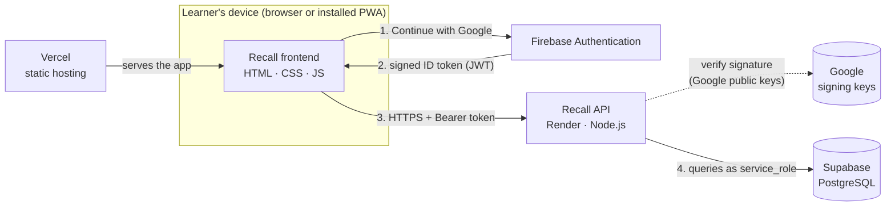
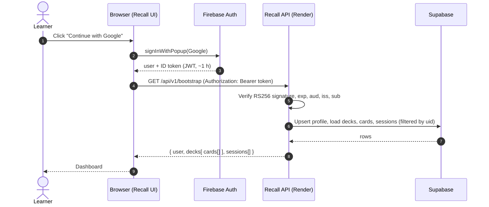
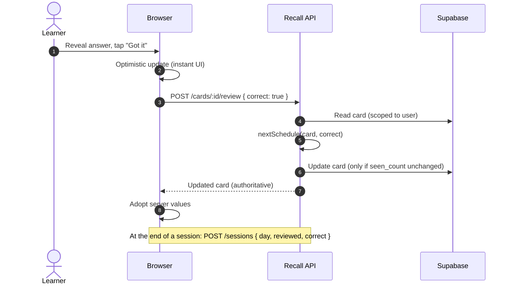
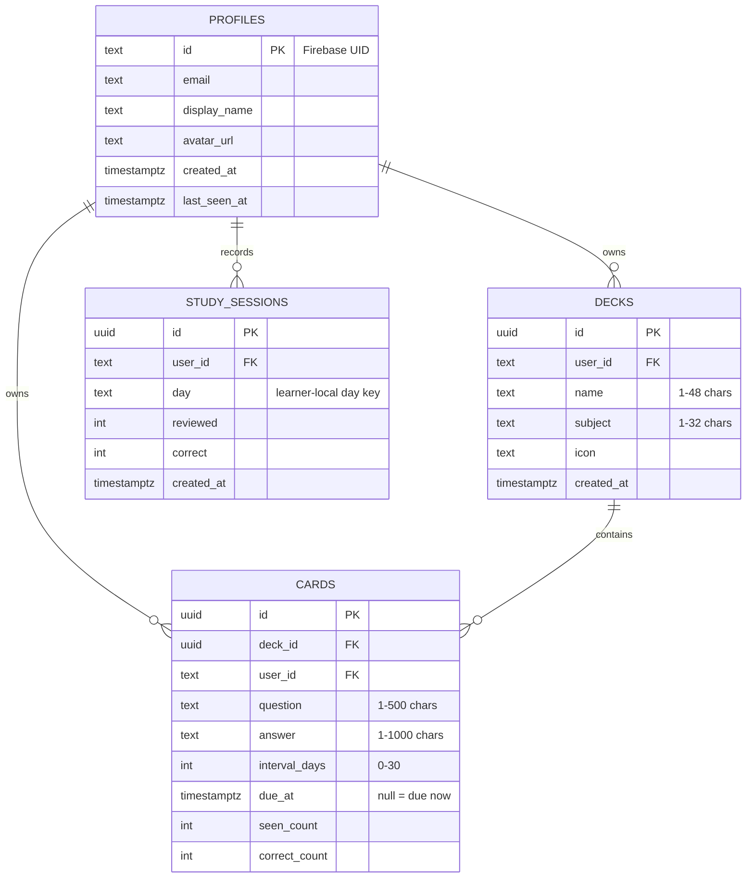
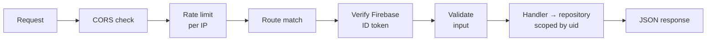
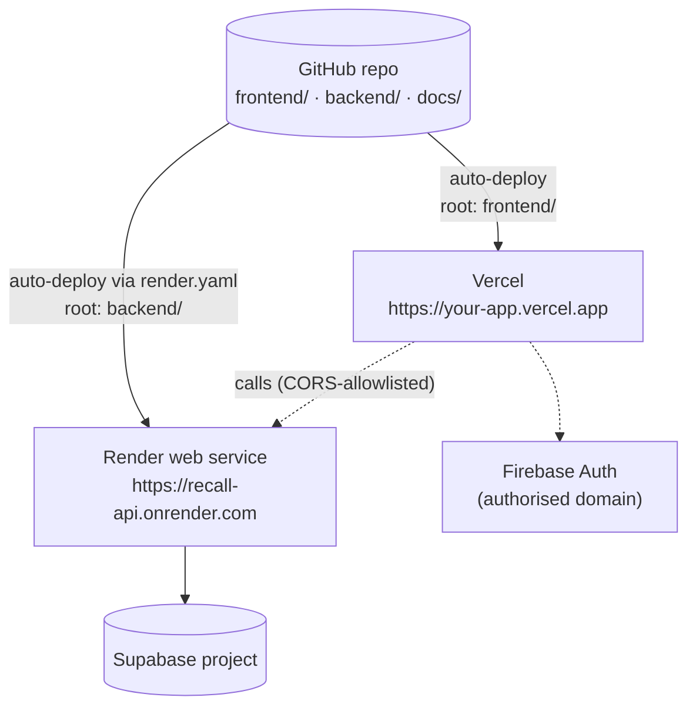

# 3. Architecture

## 3.1 System context

Four managed services, each doing one job:



| Service | Responsibility | Never does |
|---------|----------------|-----------|
| **Vercel** | Serves static files (HTML/JS/CSS/icons) | Holds data or secrets |
| **Firebase Auth** | Proves *who* the user is (Google sign-in), issues short-lived signed tokens | Stores study data |
| **Render API** | Verifies tokens, validates input, applies scheduling, enforces ownership and quotas | Trusts anything the browser claims about identity |
| **Supabase** | Stores profiles, decks, cards and sessions | Is reachable from the browser (RLS denies all) |

## 3.2 Sign-in and first load



## 3.3 Studying a card



Writes are sent **in order** through a small client-side queue, so "create deck" always reaches the server before "add card to that deck". If any write fails, the app shows a message and reloads the authoritative state from the server so the screen never silently disagrees with the database.

## 3.4 Data model



Full DDL: [`supabase/schema.sql`](../supabase/schema.sql). Deleting a profile cascades to everything it owns, which is what powers the account-deletion endpoint.

## 3.5 Backend structure

```
backend/src/
├── server.js            # starts HTTP server, graceful shutdown (SIGTERM)
├── app.js               # request pipeline: CORS → rate limit → route → auth → validate → handle
├── config.js            # reads + validates environment (fails fast)
├── auth/firebase.js     # Firebase ID-token verification (node:crypto only)
├── db/supabase.js       # PostgREST client (fetch), paging, timeouts
├── db/repository.js     # all queries, always scoped by user_id
├── routes/index.js      # the route table
├── services/scheduler.js# spaced-repetition rule (pure function)
└── lib/                 # http helpers, router, validation, rate limiter
```

Request pipeline for every call:



## 3.6 Deployment topology



Step-by-step instructions: [deployment guide](07-deployment-guide.md).

## 3.7 Design principles

1. **The browser is never trusted.** Identity comes from a verified token, never from a request field.
2. **Least privilege.** The database denies browser roles entirely; only the API holds a key.
3. **Small and explainable.** No runtime dependencies in the API; one scheduling rule; one way in and out of the database.
4. **Fail visibly.** Validation errors name the field; sync errors reach the user and trigger a re-sync.
5. **Keep the UI working.** The original interface and guest mode were kept intact; only the persistence layer changed.

Rationale for each major choice: see the [decision records](adr/).
