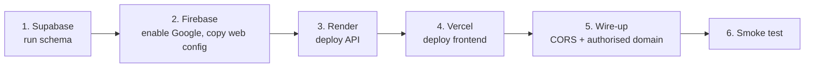

# 7. Deployment guide

**Order matters** because each step produces a value the next one needs.



Prerequisites: the repo pushed to GitHub, and free accounts on Supabase, Firebase (Google), Render and Vercel.

## 1. Supabase: database

1. Create (or reuse) a Supabase project.
2. **SQL Editor → New query**, paste all of [`supabase/schema.sql`](../supabase/schema.sql), **Run**.
3. Confirm four tables exist (`profiles, decks, cards, study_sessions`) and **RLS is enabled** on each.
4. **Project Settings → API**: note the **Project URL** and the **`service_role` secret key**.

> ⚠️ The `service_role` key bypasses RLS. It goes **only** into Render. If it ever appears in a repo, chat or screenshot, rotate it in the Supabase dashboard.

The earlier version of Recall stored data in a single `recall_data` table behind Supabase Auth. That table is not used any more and can be dropped once you no longer need the old data.

## 2. Firebase: Google sign-in

1. [Firebase console](https://console.firebase.google.com) → **Add project** (or reuse one).
2. **Build → Authentication → Get started → Sign-in method → Google → Enable**, choose a support email, **Save**.
3. **Project settings → General → Your apps → Web (`</>`)** → register an app. Copy the config values: `apiKey`, `authDomain`, `projectId`, `appId`.
4. Keep the **Project ID**: the API needs it (`FIREBASE_PROJECT_ID`).
5. You will add the Vercel domain to **Authentication → Settings → Authorized domains** in step 5. `localhost` is already authorised for local development.

## 3. Render: backend API

**Option A: Blueprint (recommended).**
1. Render dashboard → **New → Blueprint** → select the repo. Render reads [`render.yaml`](../render.yaml).
2. When prompted, enter the secret values below.

**Option B: manual.** New → **Web Service** → repo; set **Root Directory** `backend`, **Build Command** `npm install`, **Start Command** `npm start`, **Health Check Path** `/health`, plan **Free**.

| Environment variable | Value |
|----------------------|-------|
| `NODE_VERSION` | `22` |
| `NODE_ENV` | `production` |
| `FIREBASE_PROJECT_ID` | from Firebase step 4 |
| `SUPABASE_URL` | from Supabase step 4 |
| `SUPABASE_SERVICE_ROLE_KEY` | from Supabase step 4 (secret) |
| `CORS_ORIGINS` | temporarily `http://localhost:5502`; changed in step 5 |

After the first deploy, open `https://<service>.onrender.com/health`. Expect `{"status":"ok",…}`. **Copy this URL.**

## 4. Vercel: frontend

1. Edit [`frontend/config.js`](../frontend/config.js): set `apiUrl` to the Render URL and fill in the Firebase web config from step 2. Commit and push.
2. Vercel → **Add New → Project** → import the repo.
3. Set **Root Directory** to `frontend`. **Framework Preset:** *Other*. No build command, no output directory. Deploy.
4. **Copy the production URL**, e.g. `https://recall-xyz.vercel.app`.

## 5. Wire everything together

1. **Render → Environment**: set `CORS_ORIGINS` to the Vercel URL (no trailing slash). Multiple origins are comma-separated, e.g. `https://recall-xyz.vercel.app,http://localhost:5502`. Save (Render redeploys).
2. **Firebase → Authentication → Settings → Authorized domains → Add domain**: `recall-xyz.vercel.app` (host only, no `https://`).

## 6. Local development (optional)

```bash
# terminal 1: API
cd backend
cp .env.example .env        # fill in values
npm run dev                 # http://localhost:8080

# terminal 2: frontend (any static server)
cd frontend
npx serve -l 5502           # or VS Code Live Server on port 5502
```
Set `apiUrl: 'http://localhost:8080'` in `frontend/config.js` while developing, and keep `http://localhost:5502` in `CORS_ORIGINS`.

## 7. Post-deploy smoke test

| # | Check | Expected |
|---|-------|----------|
| 1 | Open `https://<render>/health` | `{"status":"ok"}` |
| 2 | Open the Vercel URL | Landing page; **Sign in** and **Continue as guest** shown |
| 3 | Sign in → **Continue with Google** | Google chooser opens; after choosing, the dashboard shows your name and email |
| 4 | Create a deck and two cards | Deck appears in the sidebar |
| 5 | Supabase → Table editor → `decks`, `cards` | Rows exist with your Firebase UID in `user_id` |
| 6 | Study a card, tap **Got it** | `cards.interval_days = 1`; a row appears in `study_sessions` |
| 7 | Hard refresh, or open on another device and sign in | Same decks and progress |
| 8 | Sign out | Back to landing page |

## 8. Troubleshooting

| Symptom | Likely cause | Fix |
|---------|--------------|-----|
| First load takes ~30–60 s, shows "Waking up the server…" | Render free plan sleeps when idle | Expected; wait, or ping `/health` every 10 min with an uptime monitor |
| Browser console: CORS error | Vercel URL not in `CORS_ORIGINS`, or has a trailing slash/typo | Fix the env var; must match the page origin exactly |
| Google popup: `auth/unauthorized-domain` | Vercel domain not authorised in Firebase | Step 5.2 |
| Popup opens then closes immediately | Browser blocks pop-ups, or an old `Cross-Origin-Opener-Policy` header | The app falls back to redirect sign-in; do not add COOP headers |
| "Sign-in is not configured yet" | `frontend/config.js` still has `YOUR_…` placeholders | Step 4.1, redeploy |
| API returns 401 for a signed-in user | `FIREBASE_PROJECT_ID` differs from the web config's `projectId` | Make them identical |
| API returns 502 `upstream_error` | Wrong `SUPABASE_URL`/key, or schema not run | Check Render logs, redo step 1 |
| Old UI after redeploy | Service worker cache | The worker is network-first; hard refresh once. Bump `CACHE_NAME` in `frontend/sw.js` on releases |
